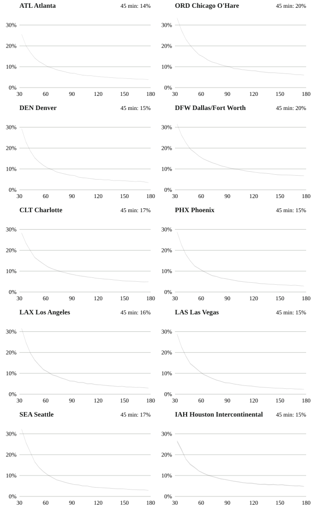

# Connection Odds

[](https://github.com/lyhjeremy/connection-odds/actions/workflows/tests.yml)

How often is a US domestic connection missed, and how long a layover does a 95% chance take? This project pairs arrivals with departures on the same airline at the 30 busiest US airports from the BTS on-time data, September 2023 to August 2026, scores each pair against what actually happened, and puts the result in a lookup tool that runs in the browser.

New in November 2026: paste an itinerary. A `claude -p` call copies the flights into a JSON schema, code parses the times, checks the airport codes and computes each layover, and the model scores every same-airline connection. On 30 synthetic itineraries it was right end to end on all 30; a bare model with no tools got every layover right but its miss probabilities were a median 9.4 points off the model's.

Result: 17% of 45-minute connections were missed, against 20.0% estimated from the inbound delay alone; on a March to August 2026 holdout the logistic model's calibration error was 0.86 points, against 2.05 for that inbound-only shortcut.

[Lookup tool](https://lyhjeremy.github.io/connection-odds/) · [Write-up](https://lyhjeremy.github.io/connection-odds/overview/)

Design and copy follow [these standards](https://github.com/lyhjeremy/lyhjeremy/blob/main/DESIGN_STANDARDS.md).


## Results

- Across the 30 hubs, 17% of 45-minute connections were missed, 8% of 90-minute ones and 31% of 30-minute ones. A miss counts a cancelled or diverted inbound, a cancelled outbound, or an inbound that reached the gate less than W + D = 30 minutes before the outbound pushed back.
- At Atlanta (ATL), the busiest hub, a 45-minute connection was missed 14% of the time and a 95% chance took 130 minutes. At 45 minutes the worst hub was Washington National (23%) and the best Baltimore (12%).
- 3.0% of pairs failed on a cancellation or diversion, which no layover fixes. Counting those, 22 of 30 hubs reach 95% within 180 minutes. If both flights operate, 95% takes 70 (BWI) to 110 (PHL) minutes, and 60 minutes for an 8 am arrival against 120 for a 7 pm one at the median hub.
- Reading only the inbound delay overstated the miss rate at 45 minutes by 2.8 points (20.0% against 17.2%). When the inbound was 30 or more minutes late, the outbound left 15 or more minutes late 40% of the time, against 24% overall. From about 120 minutes the shortcut understates instead, because it ignores outbound cancellations.
- Tested on March to August 2026 after fitting on the 30 months before, the logistic model had a calibration error of 0.86 points (Brier 0.0926), the cell-average lookup 0.93 (0.0927) and the inbound-only shortcut 2.05 (0.0941). The tool ships the model, refitted on all 36 months.
- Calendar 2019 looked much the same: 17% missed at 45 minutes.

Connections are constructed from flight pairs, not real bookings. Limits are listed in the write-up.



## Itinerary checker (agent and MCP server)

`python -m agent < itinerary.txt` reads pasted itinerary text and returns the miss probability for each connection.

1. `claude -p --model sonnet --json-schema` copies each flight into the schema in `agent/itinerary.py`: airline, flight number, airport codes, and date and time strings exactly as printed.
2. Code parses the times ("7:05p", "0715", "8:21 AM (+1)"), checks codes against the 372 airports in the BTS data (`assets/airports.json`, from `scripts/export_airports.py`), pairs consecutive flights into connections and computes each layover in minutes. A failed validation gets one repair call with the error message.
3. `agent/model.py` scores each same-airline connection at the 30 hubs. It ports `modelP` from `assets/app.js` and agrees on 2,000 of 2,000 random inputs (`scripts/check_model_port.py`, `results/model_port_check.json`).
4. Haiku writes the reply; `agent/numcheck.py` checks every number and clock time against the tool output and the parsed legs, and swaps in a template reply if any is missing.

Results on the 30 itineraries in `eval/itineraries.jsonl` (synthetic, written with their expected parses by the coding agent and frozen in commit e59bbff before any run; not human-labeled), from `eval/results.json`:

| Measure | Checker | Bare Sonnet, no tools |
|---|---|---|
| Leg fields right | 366 of 366 | not asked |
| Connection fields right | 155 of 155 | not asked |
| Layovers right (20-itinerary subset) | 23 of 23 | 23 of 23 |
| Miss probability equal to a direct model call | 24 of 24 | 3 of 17 within 2 points, median error 9.4 points |
| Numbers in the reply not found in tool output or itinerary | 0 of 205 | 34 of 137 |
| API-equivalent cost per itinerary (Claude CLI) | $0.0068 | $0.0070 |
| Latency, median (p95) | 6.3 s (9.6 s) | 2.8 s (6.3 s) |

One extraction failed validation (an arrival date of just "Sat") and was fixed by the repair call. Two replies said the model gives "no chance" for connections outside its range, meaning no figure; the number check cannot catch that. A perfect parse score on a set written by the same agent that wrote the prompt says little about real email; that is the next test.

The lookup tool also has a rule-based paste box (`assets/paste.js`, no model, nothing sent): on the 28 frozen itineraries with a connection it filled the fields exactly for 17, declined 11 and got none wrong (`scripts/check_paste_parser.py`).

MCP: `claude mcp add connection-odds -- python agent/mcp_server.py` exposes `connection_risk` and `parse_legs` over stdio (needs `mcp`). Rerun: `python eval/run_eval.py agent`, `python eval/run_eval.py baseline`, `python eval/score.py`.

## Data

US Bureau of Transportation Statistics, Marketing Carrier On-Time Performance (Beginning January 2018), monthly zips from [transtats.bts.gov/PREZIP](https://transtats.bts.gov/PREZIP/): 22,957,747 flights from 1 September 2023 to 31 August 2026, plus calendar 2019. Public domain. The marketing-carrier table is used because a traveler books the marketing airline: a SkyWest-operated United Express leg is United here. Data decisions are in [`docs/decisions.md`](docs/decisions.md).

## How to run

```bash
python -m venv ~/venvs/connection-odds && ~/venvs/connection-odds/bin/pip install -r requirements.txt
export CONN_CACHE=~/data-cache/connection-odds   # raw data stays outside the repo
python scripts/fetch_bts.py        # 48 monthly zips (about 38 MB each) to parquet in the cache; resumes
python -m pytest -q tests          # pair builder tests
python scripts/build_pairs.py      # hubs, 90.0 million sampled pairs in the cache
python scripts/analyze.py          # tables/, results/summary.json
python scripts/export_web.py       # assets/tool.json (1,564 KB)
python scripts/make_figures.py     # figures/
python scripts/export_numbers.py   # site/numbers.json
python scripts/build_site.py       # index.html, README.md, write-up fragment
```

`scripts/run_all.sh` runs everything after the fetch. No number in the README, the tool page or the write-up is typed by hand: `export_numbers.py` writes them and `build_site.py` fills the templates in `site/`.

## Repo layout

| Path | Contents |
|---|---|
| `analysis/` | `pairs.py` (pair builder and miss rule), `model.py` (logistic model), `stats.py` (Wilson intervals, calibration) |
| `scripts/` | fetcher, pair builder, analysis, exports and site builder |
| `tests/` | unit tests for the pair builder (same-tail drop, cancellations and diversions, midnight crossings), the itinerary parser and the model port |
| `agent/`, `eval/` | the itinerary checker, its MCP server, and the frozen eval with raw runs |
| `tables/`, `results/` | every table and number the pages quote |
| `index.html`, `assets/` | the lookup tool |
| `overview/` | the write-up, generated by the shared overview builder |
| `docs/` | spec and data decisions |

Stack: Python (polars, scikit-learn), plain HTML, CSS and JavaScript with inline SVG. Hosted on GitHub Pages. No third-party request is made by any page.

## License

Code under the MIT License. Flight data from the US Bureau of Transportation Statistics, public domain.
