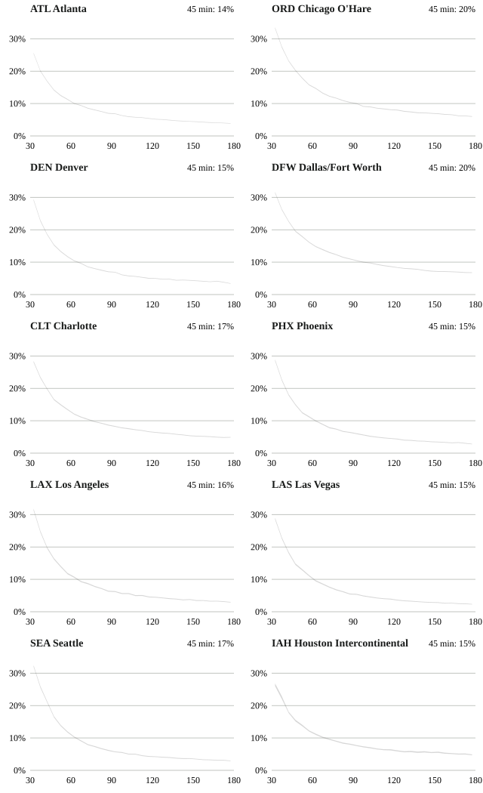

# Connection Odds

How often is a US domestic connection missed, and how long a layover does a 95% chance take? This project pairs arrivals with departures on the same airline at the 30 busiest US airports from the BTS on-time data, September 2023 to August 2026, scores each pair against what actually happened, and puts the result in a lookup tool that runs in the browser.

[Lookup tool](https://lyhjeremy.github.io/connection-odds/) · [Write-up](https://lyhjeremy.github.io/connection-odds/overview/)

Design and copy follow [these standards](https://github.com/lyhjeremy/lyhjeremy/blob/main/DESIGN_STANDARDS.md).

## Results

- Across the 30 hubs, 17% of 45-minute connections were missed, 8% of 90-minute ones and 31% of 30-minute ones. A miss counts a cancelled or diverted inbound, a cancelled outbound, or an inbound that reached the gate less than W + D = 30 minutes before the outbound pushed back.
- At Atlanta (ATL), the busiest hub, a 45-minute connection was missed 14% of the time and a 95% chance took 130 minutes. At 45 minutes the worst hub was Washington National (23%) and the best Baltimore (12%).
- 3.0% of pairs failed on a cancellation or diversion, which no layover fixes. Counting those, 22 of 30 hubs reach 95% within 180 minutes. If both flights operate, 95% takes 70 (BWI) to 110 (PHL) minutes, and 60 minutes for an 8 am arrival against 120 for a 7 pm one at the median hub.
- Reading only the inbound delay overstated the miss rate at 45 minutes by 2.8 points (20.0% against 17.2%). When the inbound was 30 or more minutes late, the outbound left 15 or more minutes late 40% of the time, against 24% overall. From about 120 minutes the shortcut understates instead, because it ignores outbound cancellations.
- Tested on March to August 2026 after fitting on the 30 months before, the logistic model had a calibration error of 0.86 points (Brier 0.0926), the cell-average lookup 0.93 (0.0927) and the inbound-only shortcut 2.05 (0.0941). The tool ships the model, refitted on all 36 months.
- Calendar 2019 looked much the same: 17% missed at 45 minutes.

Connections are constructed from flight pairs, not real bookings. Limits are listed in the write-up.



## Data

US Bureau of Transportation Statistics, Marketing Carrier On-Time Performance (Beginning January 2018), monthly zips from [transtats.bts.gov/PREZIP](https://transtats.bts.gov/PREZIP/): 22,957,747 flights from 1 September 2023 to 31 August 2026, plus calendar 2019. Public domain. The marketing-carrier table is used because a traveler books the marketing airline: a SkyWest-operated United Express leg is United here. Data decisions are in [`docs/decisions.md`](docs/decisions.md).

## How to run

```bash
python -m venv ~/venvs/connection-odds && ~/venvs/connection-odds/bin/pip install -r requirements.txt
export CONN_CACHE=~/data-cache/connection-odds   # raw data stays outside the repo
python scripts/fetch_bts.py        # 48 monthly zips (about 38 MB each) to parquet in the cache; resumes
python -m pytest -q tests          # pair builder tests
python scripts/build_pairs.py      # hubs, 90.0 million sampled pairs in the cache
python scripts/analyze.py          # tables/, results/summary.json
python scripts/export_web.py       # assets/tool.json (1,564 KB)
python scripts/make_figures.py     # figures/
python scripts/export_numbers.py   # site/numbers.json
python scripts/build_site.py       # index.html, README.md, write-up fragment
```

`scripts/run_all.sh` runs everything after the fetch. No number in the README, the tool page or the write-up is typed by hand: `export_numbers.py` writes them and `build_site.py` fills the templates in `site/`.

## Repo layout

| Path | Contents |
|---|---|
| `analysis/` | `pairs.py` (pair builder and miss rule), `model.py` (logistic model), `stats.py` (Wilson intervals, calibration) |
| `scripts/` | fetcher, pair builder, analysis, exports and site builder |
| `tests/` | unit tests for the pair builder: same-tail drop, cancellations and diversions, midnight crossings |
| `tables/`, `results/` | every table and number the pages quote |
| `index.html`, `assets/` | the lookup tool |
| `overview/` | the write-up, generated by the shared overview builder |
| `docs/` | spec and data decisions |

Stack: Python (polars, scikit-learn), plain HTML, CSS and JavaScript with inline SVG. Hosted on GitHub Pages. No third-party request is made by any page.

## License

Code under the MIT License. Flight data from the US Bureau of Transportation Statistics, public domain.
